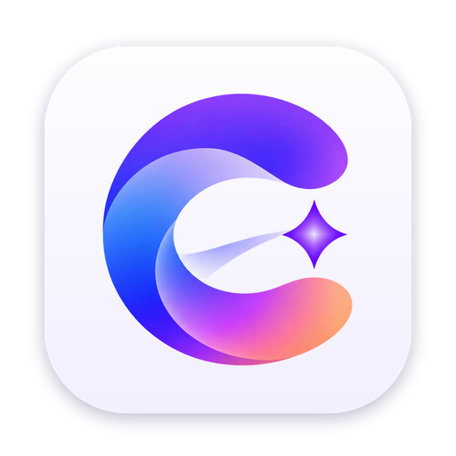

<p align="center">
  
</p>

<h1 align="center">Curio</h1>

<p align="center">A curious browser for macOS: Arc-style spaces and vertical tabs, a Dia-style assistant that reads along with you, built natively in Rust with GPUI.</p>

---

Curio is a desktop web browser. Every piece of its own interface (sidebar, tab strips, spaces, command bar, assistant, settings, menus, dialogs) is drawn with [GPUI](https://gpui.rs), the GPU-accelerated Rust UI framework behind Zed. Web pages are rendered by the system WebKit engine (`WKWebView`), embedded as a native view inside the GPUI window.

## Features

**Browsing**
- Real web pages via WebKit, with back/forward (including trackpad swipe), reload, stop, zoom, print, Web Inspector, downloads, and find in page.
- One **command bar** (⌘T / ⌘L / ⌘K) for URLs, web search, switching to open tabs, history, bookmarks, browser commands, and questions for the assistant.
- Configurable search engine (Google, DuckDuckGo, Bing, Brave, Kagi, Ecosia or a custom URL).
- ⌘-click or middle-click opens links in background tabs; `target=_blank` links and pop-ups open as Curio tabs.
- Links to other apps (`mailto:`, `zoommtg:` and so on) ask before opening.
- History and bookmarks (⌘⇧D), session restore, and default-browser support (opens `http`/`https` links from other apps).

**Tabs and spaces (Arc-inspired)**
- Vertical tabs in a sidebar by default, or a traditional horizontal tab strip (⌥⌘T). Switching keeps every tab live; nothing reloads.
- **Pinned tabs** per space, which unload instead of closing. **Favorites** are global across spaces and keep their own page state.
- **Folders (tab groups)**: create, rename, recolor, collapse, reorder, ungroup, close, and move to another space.
- Drag and drop to reorder tabs, move them into or out of folders, pin them (drop above the line), favorite them, or move them to another space (drop on a space icon).
- **Spaces** with their own name, icon, accent color, tabs, pinned tabs, folders and active tab. Switch with the space bar, Ctrl-1…9, ⌃⌘←/→ or a two-finger horizontal swipe on the sidebar. The window chrome cross-fades to the space's color.
- Background tabs are put to sleep after a period of inactivity, or when more than the configured number are loaded. They reload, scrolled back to where you were, when you return.
- Reopen closed tabs (⌘⇧T), duplicate, close others, copy link.

**Assistant (Dia-inspired)**
- A chat panel on the right (⌘E) with streaming Markdown answers, code blocks with copy buttons, multiple conversations and saved history.
- **Chat with the current tab**: the page you're viewing is attached as a visible, removable chip.
- **Chat across tabs**: attach specific tabs, or every tab in the space, and compare or summarize them.
- **Selection actions**: select text on a page to get Explain, Summarize, Translate and Ask buttons (⌘⇧E explains the selection).
- Quick actions: summarize the page, key points, compare tabs.
- Providers: **Anthropic** (default model `claude-opus-5-5`), **OpenAI**, or any **OpenAI-compatible** server (Ollama, LM Studio, OpenRouter, vLLM…). The model and base URL are configurable. API keys are stored in the macOS Keychain.

**Design**
- Light and dark themes that follow macOS, each space's accent color tinting the chrome, the page floating as a card, smooth transitions, and a native menu bar with standard shortcuts.

## Requirements

- macOS 13 Ventura or later, Apple Silicon or Intel.
- Xcode command line tools: `xcode-select --install`
- Rust 1.88 or later (stable): https://rustup.rs

## Build and run

```bash
git clone https://github.com/RatikGambhir/curio-browser.git
cd curio-browser
cargo run --release
```

The first build compiles GPUI and its dependencies and takes several minutes.

To build a standalone app bundle in `dist/Curio.app`:

```bash
script/bundle-macos.sh
```

Add `--universal` for an Apple Silicon + Intel binary, or `--dmg` to also create `dist/Curio.dmg`. The bundle is ad-hoc signed so it runs on your Mac. To distribute it, set `CURIO_SIGN_IDENTITY` to a Developer ID certificate and notarize it.

To make Curio your default browser, open the bundled app once, then choose it in **System Settings › Desktop & Dock › Default web browser**.

## Setting up the assistant

Open **Settings › AI Assistant** (⌘,), or click **Set Up AI…** in the assistant panel.

| Provider | What to enter |
| --- | --- |
| Anthropic | An API key from https://console.anthropic.com. The default model is `claude-opus-5-5`; pick another from the model menu. |
| OpenAI | An API key from https://platform.openai.com and a model name. |
| OpenAI-compatible | The server's base URL, for example `http://localhost:11434/v1` for Ollama, a model name, and a key if the server needs one. |

Press **Test** to check the connection. Keys are saved in your login Keychain under `app.curio.browser`, never in Curio's database. For development you can instead set `ANTHROPIC_API_KEY`, `OPENAI_API_KEY` or `CURIO_OPENAI_COMPATIBLE_API_KEY`.

**Privacy:** Curio sends page content to the provider only when you send a message, and only for the pages shown as chips above the message box. Content is extracted from the visible document text (form fields and passwords are never read), and it's marked as untrusted so instructions hidden in a page aren't followed. On the official Anthropic API, Curio turns on server-side refusal fallbacks for the models that support them.

## Keyboard shortcuts

| Action | Shortcut |
| --- | --- |
| New tab (command bar) | ⌘T |
| Edit address | ⌘L |
| Command palette | ⌘K |
| Close / reopen tab | ⌘W / ⌘⇧T |
| Next / previous tab | ⌃Tab / ⌃⇧Tab, ⌘⇧] / ⌘⇧[ |
| Go to tab 1–8 / last tab | ⌘1–⌘8 / ⌘9 |
| Back / forward | ⌘[ / ⌘] |
| Reload / stop | ⌘R / ⌘. or Esc |
| Find / next / previous | ⌘F / ⌘G / ⌘⇧G |
| Pin or unpin tab | ⌘D |
| Bookmark page | ⌘⇧D |
| Copy URL | ⌘⇧C |
| Duplicate tab | ⌘⇧K |
| New folder from tab | ⌥⌘G |
| New space | ⌘⇧N |
| Switch space | ⌃1–⌃9, ⌃⌘← / ⌃⌘→ |
| Toggle sidebar | ⌘S |
| Toggle vertical / horizontal tabs | ⌥⌘T |
| Toggle assistant / new chat | ⌘E / ⌘⇧O |
| Explain selection | ⌘⇧E |
| Zoom in / out / reset | ⌘= / ⌘- / ⌘0 |
| History / downloads | ⌘Y / ⌥⌘L |
| Developer tools | ⌥⌘I |
| Settings | ⌘, |

Every shortcut can be changed in **Settings › Shortcuts** (changes apply after restarting Curio).

## Architecture

```
crates/
├── curio-core      Typed IDs, tab/group/favorite and chat records, accent palette,
│                   address-bar input classification (URL vs. search)
├── curio-tabs      One space's tab strip: pinned/regular sections, folders,
│                   identity-based placement for drag and drop
├── curio-spaces    The workspace: spaces, favorites, active tabs, closed-tab stack,
│                   moving tabs and folders between spaces
├── curio-settings  Preferences (serde, forward-compatible defaults)
├── curio-storage   SQLite persistence with migrations: session, history, bookmarks,
│                   conversations, downloads, site decisions
├── curio-ai        Provider wire formats (Anthropic, OpenAI, compatible), SSE
│                   streaming on background threads, page-context prompts, Keychain
├── curio-browser   WebKit tabs: webview lifecycle and sleep, navigation, page bridge,
│                   content extraction, find in page, downloads
├── curio-ui        GPUI interface: window, sidebar, tab strip, spaces, command bar,
│                   assistant panel, settings, dialogs, theme
└── curio-app       Startup, session restore, menus, window
```

The organization crates (`core`, `tabs`, `spaces`, `settings`, `storage`, `ai`) have no UI or engine dependencies and are unit tested. The UI owns one `Workspace` model; live `BrowserTab` entities exist only for tabs that have been shown, and their webviews are created on first view and released when a tab sleeps. The session is saved to SQLite shortly after changes (debounced), and on quit.

### Why WebKit rather than Chromium

The goal was Chromium, but a stable Chromium embedding inside GPUI on macOS isn't currently practical:

- **CEF** (the Chromium Embedded Framework) on macOS requires its own `NSApplication` subclass implementing Chromium's app protocols, plus a multi-process helper-app bundle layout. GPUI installs its own `NSApplication` subclass, so the two conflict at the most basic level. Making them coexist would mean patching GPUI's platform layer or swizzling AppKit classes.
- CEF's alternative, off-screen rendering into GPU textures, gives up native scrolling, input methods, accessibility and text selection, and adds a frame of latency.

`WKWebView` is the engine behind Safari. It is maintained by Apple, keeps up with modern standards, runs each page in separate content processes, and embeds cleanly as an `NSView`. Curio embeds it through [wry](https://github.com/tauri-apps/wry) and `gpui-webview`, on GPUI Fast's window composition, which places the native view *underneath* GPUI's overlay layer. That is why Curio's menus, command bar, find bar and selection actions can float above the page. The engine sits behind `curio-browser`'s `BrowserTab` interface, so it could be swapped later without changing the UI.

**Tradeoff:** pages render with WebKit, not Blink. Most sites behave as they do in Safari. Chrome extensions are not supported.

### Security model

- Pages run in WebKit's sandboxed content processes. Curio's interface is never rendered by the web engine.
- The page bridge is the only channel from pages to Curio. It's injected before page scripts and tags messages with a per-session secret token. Every message is validated on the native side: only `http(s)` links can be opened, only registered shortcut keystrokes are accepted, and sizes are capped. The bridge can only request actions a user could perform anyway.
- Address bar input with a non-web scheme (for example `javascript:`) is searched, never executed.
- Non-web links ask before opening another app. Pop-ups become tabs.
- API keys live in the Keychain and are redacted from logs and debug output. Page text is sent to an AI provider only on send, for the visible chips.

### Data locations

| What | Where |
| --- | --- |
| Settings, session, history, bookmarks, chats, downloads list | `~/Library/Application Support/Curio/curio.db` (SQLite) |
| Cookies, caches and site storage | Managed by WebKit for the app (`app.curio.browser`) |
| API keys | Login Keychain, service `app.curio.browser` |

Set `CURIO_DATA_DIR` to use a different directory (handy for testing). Run with `RUST_LOG=debug` for verbose logs.

## Development

```bash
cargo test --workspace --exclude curio-app   # unit tests (no window needed)
cargo clippy --workspace --all-targets
cargo fmt --all
```

CI builds, tests and bundles Curio on an Apple Silicon macOS runner for every push (`.github/workflows/ci.yml`) and uploads `Curio.app` as an artifact.

## Known limitations

- **Engine:** WebKit, not Chromium (see above). No browser extensions.
- **Permissions:** camera, microphone and location prompts are WebKit's own per-site prompts. Curio doesn't yet have a settings page listing every per-site decision.
- **Page load errors:** WKWebView's provisional-navigation failures aren't exposed by the embedding layer. Curio detects a stalled load after 30 seconds and offers a retry, but doesn't yet show a custom error page for DNS or TLS failures.
- **Find in page** uses an in-page highlighter, which works on almost every site but can be blocked by pages with very strict Content Security Policies.
- **Downloads** start for any response WebKit can't display (archives, installers, and so on). A file WebKit can display, such as a PDF or an image sent with `Content-Disposition: attachment`, opens in the tab instead of downloading.
- **Shortcut changes** apply after restarting Curio.
- **One window:** Curio currently manages a single browser window. Spaces cover most multi-window use.
- **Private browsing** isn't implemented yet.
- **Picture-in-Picture, tab audio indicators and muting** aren't implemented yet.

## Roadmap

- A custom error page and certificate warnings from `WKNavigationDelegate` failure callbacks.
- Private (non-persistent) spaces using a separate `WKWebsiteDataStore`.
- Multiple windows, and tab previews in the command bar.
- A per-site permissions page.
- Tab audio indicators and mute, Picture-in-Picture.
- Assistant tool use: letting the assistant open tabs, search history and fill the command bar with your permission.
- Chromium (CEF) as an optional engine once GPUI and CEF can share an `NSApplication`.

## License

MIT OR Apache-2.0
